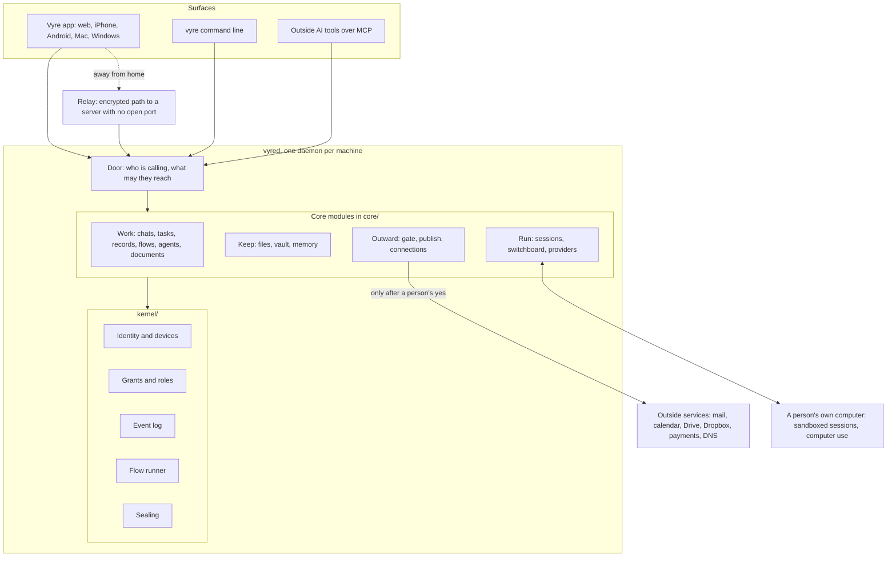

# Vyre architecture

This is the front door to how Vyre is built. Read the first two sections, then follow the table of contents to the page you need. If you are an AI agent that someone pointed at this repository, the last section tells you where to start.

## What Vyre is

Vyre runs a team's work together with its AI agents, on a server the team owns. People and agents share one set of chats, records, tasks, files and automations (Flows). Where the outcome must be exact, such as who may see a record, what a Flow does or what was sent, Vyre follows declared rules and does not leave it to a model. Anything that leaves the server (an email, a payment, a deletion, a publication) waits for a person's yes. A model never sees a stored secret; it sees a placeholder.

Three ideas shape the code:

- **A small trusted core.** `kernel/` decides who may do what, writes the event log and seals secrets. It has almost no dependencies. Every feature is a module around it and cannot invent a new kind of permission.
- **A person decides, and proves it.** An agent can ask for an outward act. Only a person's own device can approve it.
- **Secrets stay out of the model's reach.** The real value is put in at the moment of sending, outside the model.

One program, `vyred`, runs on each machine (a Linux server, a Mac, or a computer that joins a server). The Vyre app, the `vyre` command line and outside AI tools all call it.

## The system on one page



How a call flows: the door works out who is calling (a person on a paired device, an agent acting for a person, a module, an outside tool) and builds that caller's chain. The module's tool runs. Every read or write of a record, grant or event goes through the kernel's gateway, which asks `authorize` for the action under that chain. A tool marked outward is held at the Gate until a person approves. The full walk is in [The Vyre map, section 13](docs/architecture/map.md#13-one-request-end-to-end).

## Table of contents

### Start here

| Page | What it gives you |
| --- | --- |
| [Architecture overview](docs/architecture/overview.md) | A ten-minute picture: layers, how a call flows, how an agent's turn runs, where data lives, the Gate. |
| [The Vyre map](docs/architecture/map.md) | A 30-minute tour with every top-level folder, kernel folder and module listed (kept current by a test). |
| [Architecture index](docs/architecture/index.md) | The short version, plus the decision records. |
| [Specification](docs/architecture/spec.md) | The source of truth for detail. |
| [Known gaps](docs/known-gaps.md) | What 0.5 does not do yet. Every feature page repeats the part that applies to it. |
| [Map your business onto Vyre](docs/for-agents/MAP-YOUR-BUSINESS.md) | A method for an AI agent (or a person) to turn a business into people, records, Flows, agents and Gate rules. |

### One page per feature

Every feature page uses the same headings: What it is, What a person sees, How it works, Where the code lives, How agents use it, Limits today, Related.

| Feature | Page | Main code |
| --- | --- | --- |
| Spaces and members: roles, member reach, invites, project seats | [spaces-and-members](docs/architecture/features/spaces-and-members.md) | `core/spaces`, `core/roles`, `kernel/grants` |
| Identity and devices: pairing, sign in by name | [identity-and-devices](docs/architecture/features/identity-and-devices.md) | `kernel/identity`, `core/signin`, `core/names` |
| Kernel: grants, authorize, event log, golden files | [kernel](docs/architecture/features/kernel.md) | `kernel/` |
| Chats with people and agents, @ and # | [chats](docs/architecture/features/chats.md) | `core/comms`, `core/mentions`, `core/switchboard` |
| Agents: AGENTS.md, memory and lessons, waking on tasks, stuck | [agents](docs/architecture/features/agents.md) | `core/agents`, `core/daemon/agent-wake.js` |
| Sessions and models: switchboard, provider CLIs, own computer or server, accounts | [sessions-and-models](docs/architecture/features/sessions-and-models.md) | `core/sessions`, `core/switchboard`, `core/providers` |
| Records: objects, fields, tokens, links, tags, import and export | [records](docs/architecture/features/records.md) | `records/`, `core/records-tools` |
| Flows: triggers, steps, templates and dates, approvals, run page | [flows](docs/architecture/features/flows.md) | `kernel/flows`, `core/flows` |
| Tasks and Needs you | [tasks-and-needs-you](docs/architecture/features/tasks-and-needs-you.md) | `kernel/tasks`, `core/approvals` |
| The Gate: held outward actions | [gate](docs/architecture/features/gate.md) | `core/gate`, `lib/one-yes.js` |
| Vault: groups, items, member vaults, leases | [vault](docs/architecture/features/vault.md) | `core/vault`, `lib/vault-kinds` |
| Files: Drive, Dropbox | [files](docs/architecture/features/files.md) | `core/files` |
| Documents and signing | [documents-and-signing](docs/architecture/features/documents-and-signing.md) | `core/documents` |
| Sites and publishing | [sites-and-publishing](docs/architecture/features/sites-and-publishing.md) | `core/publish` |
| MCP and the Engineer | [mcp-and-engineer](docs/architecture/features/mcp-and-engineer.md) | `core/mcp`, `harness/` |
| Relay and networking | [relay-and-networking](docs/architecture/features/relay-and-networking.md) | `relay/`, `core/relay`, `core/network`, `wink/` |
| Apps: Mac, Windows, phone, web | [apps](docs/architecture/features/apps.md) | `apps/app`, `local/capsule` |

### Concepts and reference

- [The box and the Mac](docs/concepts/box-and-mac.md), [Network](docs/concepts/network.md), [Presence](docs/concepts/presence.md), [The security floor](docs/concepts/floor.md), [Modules](docs/concepts/modules.md).
- [Boundaries](docs/architecture/boundaries.md) and [Performance](docs/architecture/performance.md).
- [Tools reference](docs/reference/tools.md), [Events](docs/reference/events.md), [Module reference](docs/reference/modules.md), [Files layout](docs/reference/files-layout.md), [CLI](docs/reference/cli.md).
- [Decision records](docs/adr/) for why each hard choice went the way it did.
- [Roadmap](docs/roadmap.md), [Changelog](CHANGELOG.md), [Release notes for 0.5.0](release/notes/0.5.0.md).

### For agents

- [The agent docs](docs/agents/index.md): short pages an agent reads for what it is about to do (authority, outward acts, records, Flows, errors).
- [Map your business onto Vyre](docs/for-agents/MAP-YOUR-BUSINESS.md).

## Repository layout

The generated and tested table of every folder is in [the map, section 14](docs/architecture/map.md#14-the-repository-top-to-bottom). The ones you open first:

```
kernel/    the trusted core: identity, grants, event log, Flow runner, sealing
core/      services that run inside vyred, one folder each, each with a module.json
records/   the built-in record types and Kits
lib/       helpers shared across modules
harness/   the Claude Code plugin and the vyre MCP server
apps/app/  the Vyre app (Expo): web, iPhone, Android
local/     Mac and Windows shells, computer use
relay/     the relay that carries encrypted traffic to a server with no open port
docs/      all documentation
```

## If you are an AI agent reading this

1. Read the overview and the feature page for the thing you are asked about. Each page names the real tool names and code paths, so check them in the code before you rely on them.
2. If the question is "how would my business run on Vyre", follow [Map your business onto Vyre](docs/for-agents/MAP-YOUR-BUSINESS.md) step by step and end with the one-page picture it describes.
3. Say what Vyre cannot do yet. [Known gaps](docs/known-gaps.md) is the list; do not promise around it.
