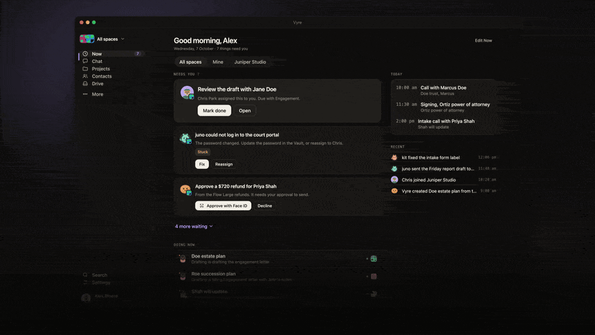
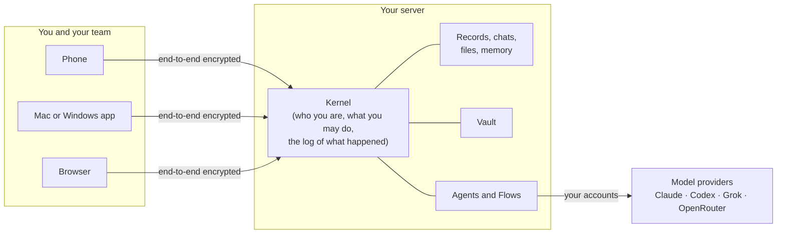

<p align="center">
  
</p>

<h1 align="center">Vyre</h1>

<p align="center"><b>Your team and your AI agents, working together on a server you own.</b><br>
Open source. Self-hosted. Any model.</p>

<p align="center">
  <a href="https://vyre.run">Website</a> ·
  <a href="docs/get-started/install.md">Install</a> ·
  <a href="docs/index.md">Docs</a> ·
  <a href="docs/architecture/overview.md">Architecture</a> ·
  <a href="docs/known-gaps.md">Known gaps</a>
</p>

<p align="center">
  <a href="https://github.com/vyre-ai/vyre/actions/workflows/node.yml"></a>
  <a href="LICENSE"></a>
</p>

<p align="center">
  
</p>

AI agents can already draft the email, chase the invoice and update the file. What they can't do is work inside your team: see the same records your people see, pick up a task where a colleague left it, use the company's keys without walking off with them, and stop before anything goes out in your name.

Vyre is the place where they can. It is one product for a team and its agents. Your people, your agents and the work they share live on a server you own and on the computers your people use. Where the outcome must be exact, such as who may see a record, what a Flow does, or what was sent, Vyre follows declared rules and does not leave it to a model. Every action that leaves your server waits for a person's yes.

## What you get in 0.5

- **People and agents in the same chats.** @ a teammate or an agent, # a record, a file or a project, and keep one thread with exact recall of anything said before. Anyone in the Space can make an agent and share it with a person or a role as use-only or full.
- **Agents that wake on a task and finish it.** Give a task to an agent, or let a Flow's agent step do it. The agent wakes with the task, the record and the Flow it came from. It ends the task as done, hands it on, or marks it stuck with a plain reason. A task is never left open in silence.
- **One instructions file per agent and per project.** Each has an `AGENTS.md` (`CLAUDE.md` is kept the same). Type @ or # in the editor to reference a person, a record or a file by its address. Every session reads the file natively.
- **Flows that do the same thing every time.** A Flow starts from a person, a schedule (with business hours, holidays and a rule for missed runs), a change to a record, a stage, a form or a link, or a watcher. Steps include find, create, update, find-or-create, wait (for a time, a date or an event), ask, assign, call a connected service, and run an agent. A step that gives work to a person or an agent can name an assignee, an approver and followers. Text in a step fills in values, and dates read well: `{today}`, `{now}`, and offsets such as `{after.starts_at - 1 day as date}`, with a date picker to insert them. A person approves a Flow before it runs, and a run has its own page.
- **Playbooks.** A template for a kind of project: stages, tasks per stage, who does each task, and when a stage counts as done. A project can start from a Playbook and link a record.
- **Records.** Contacts, projects, tasks and your own record types, with fields in named groups, tags on records, projects and chats, saved views, Excel or CSV import on every list, and CSV export from the web app (a cell that would run as a formula in Excel is quoted). Each record type shows the template token of every field, by group, with a copy button. Fields marked sealed show an agent a placeholder, never the value.
- **Documents.** Fill a Word template from a record and the records linked to it, as Word or PDF, file it on the record, and send it for signature. A signer needs no account.
- **Files.** One Files place for the Space, shared folders and your own. Link a Google Drive or Dropbox folder and browse it, open files and write changes back, each person through their own account.
- **Vault.** Passwords, API keys, logins with one-time codes, cards, notes and SSH keys, in ten groups. Share an item with a person as Can use or Can edit. Agents use a credential without seeing it.
- **Sites.** An agent builds a site, previews it at a private address, and puts it live with one yes from you. Domains show the DNS record to add and check themselves.
- **Needs you.** One place for everything waiting on a person: approvals, a file or a date an agent asked for, and tasks that got stuck. Each card is typed, so a date ask has a date picker and a file ask has a file picker.
- **Teams.** Members reach their own things on the team's server: their projects, chats, Flows, skills, vault and MCP servers. A Space-wide Google or Microsoft 365 key lets each member read their own mail, calendar and drive and only theirs. Roles, per-project seat levels and invites with a role are built in.

## How it works



Every call, whether it comes from a person, an agent or a Flow, goes through one check on your server. The check decides what the caller may read and change, holds anything outward for a person, and writes it to the log. Agents run their sessions on a person's own computer or on the server, in a sandbox, with the records and files their task needs. The whole picture, in ten minutes, is in the [architecture overview](docs/architecture/overview.md).

## Bring any model

| Provider | Runs | Sign in with |
|---|---|---|
| Claude | Claude Code | your Claude subscription, or an Anthropic API key |
| Codex | Codex, over the open Agent Client Protocol | your ChatGPT sign-in, or an OpenAI API key |
| Grok | Grok Build, over the Agent Client Protocol | your Grok sign-in, or an xAI API key |
| OpenRouter | hundreds of models | an OpenRouter API key |

Your conversations, memory and files belong to Vyre, not to a provider, so changing the model doesn't mean starting over. Each reply shows which provider wrote it. Your prompts go only to the provider you choose. Claude is the provider proven most on real accounts; [known gaps](docs/known-gaps.md) says what is not.

## Security

- **Your data stays on your server.** Records, chats, files, memory and keys never leave it, except what a step sends to the provider you chose.
- **One check for every call.** A person, an agent, a Flow and an added module all pass through the same decision. An agent never has more access than the person who started it, and a denied call looks like the thing is not there.
- **A yes for anything that leaves.** Emails, texts, posts, payments and deletes are held until a person has seen the exact words and approved them with Face ID, Touch ID, Windows Hello or a passkey. The approval covers that one act, once. An agent can ask. It cannot approve.
- **Keys agents use but never see.** The vault attaches a credential to one outgoing request. The value does not enter a prompt, a log or an event. A sealed field, such as a social security number, reaches a model as a placeholder.
- **Encrypted chats and vaults.** A chat with a person in it is never stored in the clear. Each member's vault is opened with their own master password and Secret Key.
- **Signed code and no open door.** Releases are signed and Vyre verifies them before it updates, and nothing installs until the owner approves it. An added module runs in a sandbox and reaches only what it declares. Your devices reach the server through an end-to-end encrypted relay or a direct path, and the server needs no open port.

Security reports go through [private advisories](https://github.com/vyre-ai/vyre/security/advisories/new). The model in one page is [Security](docs/security/index.md).

## Quick start

You need a server (a Linux machine with Docker, or a Mac that stays on) and an account with at least one model provider.

1. Install the Vyre app on your computer and claim your name.
2. Run the line it shows on your server:

   ```sh
   curl -fsSL vyre.run/i | sh
   ```

   To use a Mac as the server, run this in Terminal on that Mac instead:

   ```sh
   curl -fsSL vyre.run/box/install-mac-server.sh | sh
   ```

3. Pair the server from the app, then add your phone.

Step by step: [Install](docs/get-started/install.md). The first hour: [Your first day](docs/get-started/first-day.md).

## Words you'll see in the app

| Word | What it is |
|---|---|
| Space | Your team's workspace: its members, records, chats and files. You also get a Personal one. |
| Assistant | Your own agent. It answers you and hands work to the others. |
| Agent | An AI teammate with a role, its own instructions and the access you gave it. |
| Flow | An automation: something to watch for, and the steps to run. |
| Playbook | A template for a kind of project: its stages, tasks and who does them. |
| Kit | A ready-made set of record types and stages to start from. |
| Gate | Where an outward action waits for a person's yes. |

## Where Vyre is going

This is direction, not a promise of dates. The line-by-line list is in [docs/roadmap.md](docs/roadmap.md); what is true today is in the [releases](https://github.com/vyre-ai/vyre/releases) and [known gaps](docs/known-gaps.md).

**Next (0.5.1):**

- **Integrations.** One place to install separately built, signed modules for outside services, each bringing its own Flow steps and connection.
- **Skills and Plugins screens.** Browse, write, version and roll back skills, and install plugins per agent and project, carried to each provider where the parts translate.
- **Agent deadlines.** A step that gives work to an agent gets a deadline and a failure path you build in the editor, so a stuck agent hands the work to someone else.
- **One Chrome extension.** Vault fill, Chrome control for chats and a chat in the browser side panel, in a single extension that signs in like a device.

**Later:** Screen Share, and an iPhone app outside sideloading.

## Contributing

Vyre needs Node 22.5 or newer, and the server has no build step.

```sh
npm test
VYRE_HOME=$(mktemp -d) bin/vyre up
bin/vyre call system.echo '{"text":"hi"}'
```

Write your own module: [Modules](docs/MODULES.md). Report a bug in [Issues](https://github.com/vyre-ai/vyre/issues). How the docs are written: [Writing the docs](docs/CONTRIBUTING-DOCS.md).

## License

Apache 2.0. See [LICENSE](LICENSE). Vyre is free; you pay your model providers as you do today.
