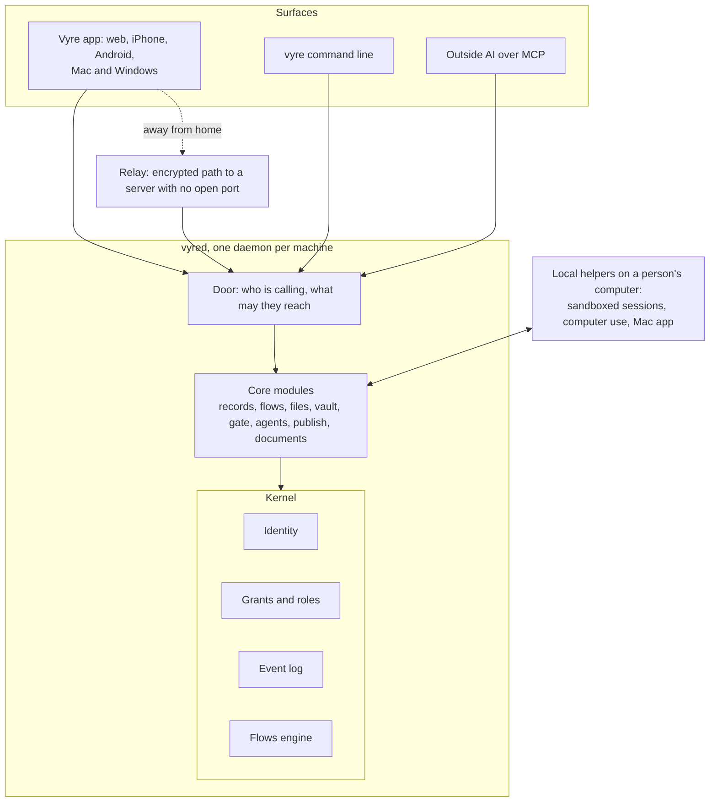
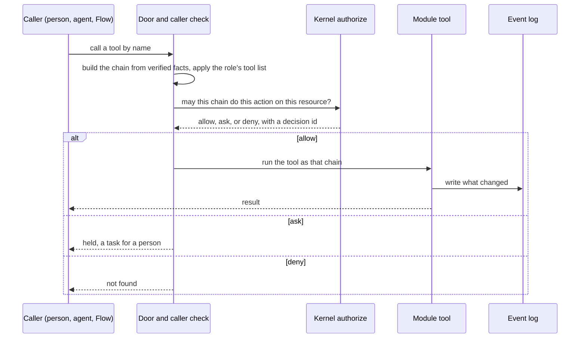
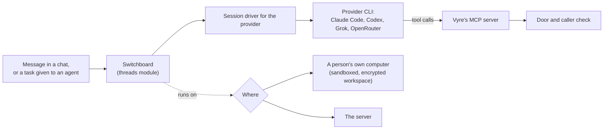
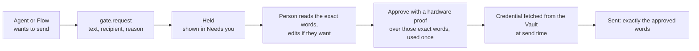

# Architecture overview

Read this page first. It takes about ten minutes and gives you the picture. [The Vyre map](map.md) is the longer tour of the same ground (30 minutes, with every module listed), and the [specification](spec.md) is the source of truth for detail.

Vyre is one product for a team and its agents. It runs on a server you own and on the computers your people use. Three ideas shape all of it:

- **One small trusted core.** The code that decides who may do what, keeps the history and holds secrets is small and separate. Features are modules around it, and a module cannot invent a new kind of permission.
- **A person decides.** Anything that leaves your server waits until a person has seen the exact words and approved them. An agent can ask. It cannot approve.
- **Secrets stay out of the model's reach.** A model sees a placeholder. The real value is put in outside the model, at the moment of sending.

## The layers

| Layer | What it holds | Where in the repository |
| --- | --- | --- |
| Kernel | Identity (keys and the signed list of devices that speak for a person), grants and the five roles, the event log, tasks and approvals, the sealing process, and the Flows engine. Almost no dependencies, and the same code runs on a server, a phone and a browser. | `kernel/` |
| Core modules | The services features are made of: records, chats, files, vault, the Gate, agents, sessions, publishing, documents, connections. Each is a folder with a `module.json` and registers tools and events. | `core/`, `records/` |
| Apps | The Vyre app (one Expo codebase for web, iPhone and Android) and the Mac and Windows shells around it. They talk to the daemon's API and never read a store directly. | `apps/`, `local/capsule/` |
| Relay | Lets a paired device reach a server that has no open port. It carries only encrypted traffic between devices that proved each other's keys. | `relay/`, `names/`, `escrow/` |
| Local helpers | Code that runs on a person's own computer: running a Space's sessions in a sandbox, computer use, the Mac app. | `local/`, `core/runner/` |

Every machine runs the same daemon, `vyred`. Config says whether the machine is a server, a solo Mac or a device that joins a server, and that picks which modules start. Details: [The box and the Mac](../concepts/box-and-mac.md) and [Modules](../concepts/modules.md).

## How a call flows

A person using the app, an agent in a session, a Flow step and an outside AI connected over MCP all make calls the same way.

1. **The chain.** Authority is never read from a name or a header. The daemon builds a chain from facts it verified itself: which paired device, which signed session, which agent that person started, which Flow step. The call has the intersection of what every link in the chain may do, so an agent never has more than the person who started it.
2. **The door.** Before a tool runs, a gate at the registry applies the caller's role. A guest or a member sees only the tool list their role allows, and some tools refuse anything but a person at their own device.
3. **Authorize.** The kernel answers allow, ask or deny. Ask becomes a task for a person. Deny looks like absence: the caller is told the thing is not found, and the real reason goes to the log.
4. **The tool.** A module tool does the work. Every read and write of a record goes through one gateway.
5. **The log.** Every decision and change is an event: who, what, when, and the full chain. Events are hash-linked and checkpointed, so a rollback is detectable.

Deeper: [the map, sections 4 and 13](map.md), [the security floor](../concepts/floor.md) and [Security](../security/index.md).

## How an agent's turn runs

- **Switchboard.** The `threads` module (in `core/switchboard/`) starts headless sessions and streams them to every surface. A chat is a Vyre thread, so changing the provider mid-conversation does not lose it.
- **Provider CLIs.** Each provider has a driver in `core/sessions/`. Vyre starts the provider's own command-line agent with only Vyre's MCP server configured, and every tool call the model makes comes back through the door above, as the person or agent the session belongs to.
- **Where it runs.** A person can run sessions on their own computer, in a sandbox and an encrypted workspace that opens only while the Space leases its key. Otherwise the session runs on the server. The chat shows which. See [Run a space's work on your own computer](../using/local-runner.md).
- **Waking on a task.** When a task is given to an agent (by a person, by `tasks.request` or by a Flow's agent step), `core/daemon/agent-wake.js` starts one job session with the task, its record and where it came from. The agent finishes the task, hands it on, or marks it stuck, and a job that ends without doing so is marked stuck with the reason.
- **Instructions.** Each agent and each project has an `AGENTS.md`. A session starts in its project's folder and reads it natively.

## Where data lives

| What | Where |
| --- | --- |
| Settings, the daemon's database, logs, the socket | The Vyre home on each machine: `~/.vyre`, or `VYRE_HOME`. On a Linux server it is inside a Docker volume. |
| A Space's kernel (identity, grants, event log) | `kernel.db` for that Space in the home. The personal Space's tables are in `vyre.db`. |
| Records | The built-in SQLite store, or one Twenty CRM database per Space behind the same interface. |
| Files | The Space's Drive: encrypted chunks over local disk, S3 or a device. Linked Google Drive and Dropbox folders stay at the source and are read through each person's own account. |
| Vault items | `vault/` in the home, sealed at rest. A member's own vault is opened with their own master password and Secret Key. |
| Sealed fields | Only inside the sealing process, a separate child process. |
| Keys that prove a person is there | Hardware on the person's device: Secure Enclave, TPM, StrongBox or a passkey. They never reach the server. |
| Chat sessions | The machine that ran them. A chat can move between a person's computer and the server with its turns. |

The full table, including the Linux box and Mac server layouts, is in [the map, section 12](map.md).

## The Gate

The Gate is the hold queue for everything that leaves your server: an email, a text, a post, a payment, a delete, a publication.

- An agent cannot approve, revise or reject. Those calls refuse an agent caller.
- The proof is a signature over the exact request, made on the person's own device with Face ID, Touch ID, Windows Hello or a passkey. It works once and for that act only.
- Which operations count as outward is declared, not guessed. A connector marks each operation as read, draft, change, send, spend or delete, and anything undeclared cannot be called.
- A failed send goes back to held. Two screens approving at once send once.

Deeper: [the map, sections 5 and 13](map.md) and [Presence](../concepts/presence.md).

## The top-level folders

| Folder | What it holds |
| --- | --- |
| `kernel/` | The trusted core: identity, grants, event log, tasks, sealing, the Flows engine. |
| `core/` | The daemon and the core modules, one folder each. |
| `records/` | The records language, Kits (starter record types and Flows) and connector declarations. |
| `lib/` | Shared pure code: crypto boxes, identity helpers, the view engine, release signing. |
| `apps/` | The Vyre app (Expo): web, iPhone and Android. |
| `local/` | Modules for a person's own computer: the Mac app, computer use, voice, the Windows app. |
| `modules/` | Optional first-party modules and the vault's browser extension. |
| `harness/` | The Claude Code plugin: hooks, the MCP server, skills, the status line. |
| `relay/` | The relay that lets a paired device reach a server with no open port. |
| `names/` | The name directory (a Cloudflare Worker). |
| `escrow/` | The Worker that keeps each identity's sealed Secret Key for GitHub sign-in. |
| `wink/` | The Go forwarder for Vyre's own network, built into the server image. |
| `stores/` | Record stores behind the kernel's store interface; today the Twenty store. |
| `box/` | The server's Docker image, compose files and host command. |
| `packages/` | The module SDK: the manifest schema and its checker. |
| `examples/` | Example modules to copy from. |
| `site/` | The public website. |
| `docs/` | These docs, the specification and the decision records. |
| `scripts/` | Installers, the docs build, test and walk harnesses. |
| `test/` | Tests that cross folders. |
| `release/` | Release data and release notes. |

The generated list of every folder is in [the map, section 14](map.md). To build on Vyre, start at [the module contract](../build/module-contract.md); to change it, start at [Contributing](../contributing/index.md).
