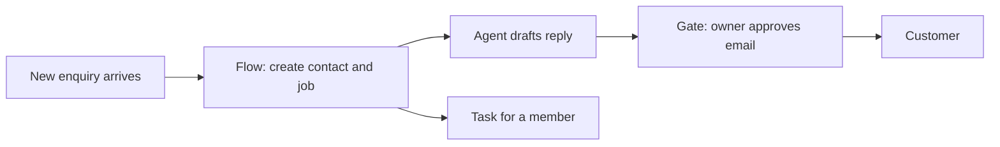

# Map your business onto Vyre

This page is written for an AI agent that a business owner pointed at this repository. The owner wants to know: how would my business run on Vyre, and what would it look like there? Work through steps 1 to 7 in order, check each Vyre name against the feature page it links to, then give the owner the one-page picture in step 8.

Do not assume an industry. Take every noun from what the owner tells you. If the owner has not said, ask. Do not invent people, record types or systems.

## Ground rules

- Vyre describes what exists today. Where a step below says "not yet", say so to the owner. [Known gaps](../known-gaps.md) is the list.
- Names in backticks are real tool names or paths. Before you promise anything, confirm the tool in [the tools reference](../reference/tools.md) or the module's `module.json`.
- Mapping is a design on paper. You change nothing in a Space until the owner says to, and every outward act stays held for a person's yes.

## Step 1. Interview, then list

Ask these six questions and write the answers down in the owner's own words.

1. Who works here, and what may each of them see or change?
2. What things do you keep track of (customers, jobs, orders, cases, assets)?
3. What work repeats, and what starts it?
4. What work needs judgment that a person now does from a checklist or from experience?
5. Which outside systems do you use (mail, calendar, a file store, a payment tool, a website)?
6. What must never go out without a person saying yes (an email to a customer, a payment, a deletion, a post)?

## Step 2. People and roles become members and roles

| Owner says | Vyre has | Check |
| --- | --- | --- |
| The business as a whole | One Space | [Spaces and members](../architecture/features/spaces-and-members.md) |
| Owner, partners | Role Owner or Admin | same page |
| Staff who do the work | Role Member | same page |
| An outside contractor or client who sees one job | Guest, limited to one project and ending on a date | same page |
| "Our bookkeeper may see invoices but not salaries" | A custom role (what it can do, where, which data, which tools) | same page, Roles |
| "Anna leads the Smith job, Ben only watches it" | A project seat: Lead, Contributor or Viewer | same page |

Write one line per person: name, role, which projects, what they must not see. Mark anything sensitive for step 3.

## Step 3. Things they track become record types, fields and links

For each noun from question 2, decide: is it one of the built-in types, or a type of their own?

- Built in: `contact`, `organization`, `project`, `task`, `event`, `template`, `playbook` (see `records/core-types.js`). Use these first. A contact or organization can play a role such as client or supplier.
- Their own: a record type with fields, defined in Customize (the app calls these Objects) or with `records.define`. See [Records](../architecture/features/records.md).

For each type list:

1. **Fields** and their kinds (text, number, money, date, choice, link, file, stage, sealed and others). Group them under names a person would use.
2. **Links** between types. A job links to its customer, an invoice links to its job. A link gives the other side an inverse field, so you can list "all jobs for this customer".
3. **Stages**, if a record moves through a pipeline (new, quoted, booked, done). A record entering a stage can start a Flow.
4. **Sealed fields**, for anything an agent must never read (a national ID, a bank number). An agent sees a placeholder only.
5. **Who may see it.** `hidden_from` hides a field from named roles. 0.5 limit: a member can read every row of a type the Space defined itself, so keep sensitive rows in a built-in type or leave that person out of the Space (see the limits below).
6. **Tags** for loose grouping, and **import**: Excel or CSV into any list from the web app.

Every field has a template token, shown in the app by group. Flows and Word templates use those tokens, so choose field names carefully.

## Step 4. Repeated work becomes Flows, Playbooks and stage tasks

For each repeated piece of work write a sentence: "When X happens, do A, then B, and ask Y before C." Then map it.

| Part of the sentence | Vyre piece |
| --- | --- |
| When a person starts it, on a schedule, when a record changes, when a record enters a stage, when a form arrives, or when something new shows up in a mailbox or folder | The Flow trigger: person, schedule, record change or stage, form, watcher |
| Look something up, create or update a record, find or create | Steps find, create, update, upsert |
| Wait until a date, a time or an event | Step wait |
| Ask a person or a role, and continue on the answer | Step ask (people and roles only) |
| Give a task to a person, with an approver and followers | Step assign |
| Send an email or a text | A service step that goes through a connection, held for a yes |
| A judgment call | Step agent: hand to an agent (step 5) |
| Do this for each item | Step repeat |

Then:

- If the work is the same for every job of a kind, with the same stages and the same tasks at each stage, make it a **Playbook**: stages, tasks per stage, who does each task, and when a stage counts as done. A project starts from a Playbook.
- If the work is a chain of actions around records, make it a **Flow**. A Flow is written once, a person approves it, and it runs the same way every time. A run has its own page with a step timeline.
- Write in values from records with tokens, and dates such as `{today}`.

Details and limits: [Flows](../architecture/features/flows.md) and [Tasks and Needs you](../architecture/features/tasks-and-needs-you.md). For the exact Flow keys read the Flows cheat sheet (agent doc "flows-cheatsheet").

## Step 5. Judgment work becomes agents with an AGENTS.md

For each judgment task in question 4, define an agent:

1. **Job**: one sentence ("Reads each new enquiry and drafts a reply from our price list").
2. **AGENTS.md**: the agent's instructions. Write what it should do, what it must not do, where its files are, and who to ask. Point at records, people and files with @ and # references.
3. **Reach**: the projects it may work in.
4. **Tools and secrets**: what it may use. Give it use of a vault item without letting it see the value.
5. **Who may use it**: share with a person as Can use or Can edit.
6. **How it is woken**: a task assigned to it, or a Flow's agent step. It ends the task as done, hands it on, or marks it stuck with a plain reason, and the stuck task shows up under Needs you.

Keep agents narrow. A drafting agent and a booking agent are two agents. See [Agents](../architecture/features/agents.md) and [Sessions and models](../architecture/features/sessions-and-models.md).

## Step 6. Outside systems become connections

Today a Space reaches an outside service in these ways. Check each against [Files](../architecture/features/files.md), [Vault](../architecture/features/vault.md) and the connections page for agents (agent doc "connections").

- Mail, calendar and drive through a connected Google or Microsoft 365 account. Each member reads only their own. The Microsoft 365 app is read-only.
- Google Drive and Dropbox folders linked as Files.
- A sending service for email (Resend, Mailgun, Postmark, SendGrid or SMTP) and texts through your own Twilio account, used by a Flow's service step.
- A connection: a declared host, how the key is sent and a list of operations, each marked read, draft, change, send, spend or delete. Only a person adds one.
- MCP servers a person adds.
- Documents: Word templates filled from records and sent for signature. See [Documents and signing](../architecture/features/documents-and-signing.md).
- A site that an agent builds and previews, with go-live held for a yes. See [Sites and publishing](../architecture/features/sites-and-publishing.md).

For anything else, list it as a gap. Signed, separately installed Integrations for outside services are on the roadmap and are not in 0.5. Until then, a connection or an MCP server is the way in.

## Step 7. What must never go out without a yes becomes the Gate

List every act that leaves the Space: emails to customers, payments, deletions, posts, publishing, sharing. Each one is held at [the Gate](../architecture/features/gate.md) until a person approves the exact words on their own device. An agent can ask. It cannot approve. Tell the owner:

- Which acts are held by default: anything a tool marks outward.
- That an approved Flow version can carry one yes for named destinations and limits, and that a step marked to approve, a recipient taken from outside content, or a hit limit still stops for a person.
- That a person can save a standing permission for a repeated safe act.

## Step 8. Give the owner a one-page picture

End with one page, in the owner's words, with these headings. Keep it to one screen.

1. **The Space**: its name, who is in it and their roles, with the sensitive limits.
2. **What we track**: the record types, their key fields and how they link, as a small list or diagram.
3. **What runs by itself**: each Flow or Playbook as "when X, then Y, ask Z".
4. **Who your agents are**: name, job, who may use it.
5. **What connects**: each outside system and how.
6. **What waits for you**: the acts held at the Gate and the asks that reach Needs you.
7. **What Vyre cannot do for you yet**: copy the relevant lines from the limits below.

A diagram helps. For example:

## Limits to tell the owner

Check [Known gaps](../known-gaps.md) for the current text. In 0.5:

- A member can read every row of a record type the Space defined itself. Per-record privacy for custom types is planned for 0.5.1.
- A Flow's "For each" step handles up to 50 items in the editor, and a longer list is cut without a note on the run page.
- An agent step has no deadline. A session that ends without finishing is marked stuck; one that never ends is not timed out.
- A Flow email cannot carry CC, BCC or attachments, and members cannot inspect a Flow over MCP.
- CSV export is in the web app only.
- A member cannot add a setup token or API key as their own AI account, and the Microsoft 365 app is read-only.
- Only Claude has been run end to end on real accounts. Codex and Grok work against recorded sessions. There is no Gemini.
- Nothing has been walked on a real iPhone or Android yet, and native push is not set up. Web push works.
- Windows is a device that works against a server, not a home that runs sessions.
- Integrations for outside services are not built. Use a connection or an MCP server.

## Worked example 1. A small design studio

The owner says: "Six people. We win projects from enquiries, quote them, design in rounds, get client sign-off, then invoice. Freelancers join some jobs. I want enquiries answered the same day and nothing sent to a client without me seeing it."

**People and roles.** The owner is Owner. The studio manager is Admin. Four designers are Members. Freelancers are Guests limited to one project each, ending when the job ends. A custom role "Finance" lets the bookkeeper see invoices and not briefs. On a project, the designer who runs it is Lead and the others are Contributors.

**Records.**

| Type | Built in or own | Key fields | Links |
| --- | --- | --- | --- |
| Client | `organization` and `contact` | name, email, phone, bank account (sealed) | contacts link to the organization |
| Enquiry | own | source, summary, budget (money), received (date), stage (new, quoted, won, lost) | to a client |
| Job | `project` | name, due (date), stage (briefed, round 1, round 2, signed off, invoiced) | to a client and an enquiry |
| Invoice | own | amount (money), due (date), paid (boolean) | to a job; hidden from roles other than Finance |

**Flows and Playbook.**

- Flow "New enquiry": triggered by a form or an inbound call to the Flow's path. It finds or creates the client, creates the enquiry in stage "new", and assigns a task to the studio manager. It hands the enquiry to the "Enquiry reply" agent, which drafts a reply.
- The reply is an email. It goes out through the studio's sending service as a held act: the owner sees the exact words under Needs you and approves or edits.
- Flow "Quote follow-up": triggered by an enquiry entering stage "quoted". Wait five days, ask the owner "Chase this quote?", and if yes draft a follow-up for approval.
- Playbook "Design job": stages briefed, round 1, round 2, signed off, invoiced, with a task per stage (collect brief, send round 1, record feedback, fill sign-off document) and a person on each.
- Document: a Word template "Sign-off" filled from the job and its client, filed on the job and sent for signature. The client needs no account.

**Agents.** "Enquiry reply" has an AGENTS.md with the studio's tone and price list and works in the enquiries project only. Members can use it. Only the owner can edit it.

**Connects.** Each member's own Google mail and calendar, a Drive folder linked as Files for design deliverables, the studio's email-sending service, and a site that the studio manager asks an agent to build, with go-live held for the owner.

**What the owner sees.** Needs you shows two things each morning: replies to approve and quotes to chase. Invoices are visible to Finance only. The one-page picture lists the limit that a Member can read every Enquiry row, so enquiries with private notes go in a built-in type or stay out of Members' reach.

## Worked example 2. A home-services company

The owner says: "We fix and install things in people's homes. Customers call or fill a form, we book a visit, a technician goes, we invoice and ask for a review. I have a dispatcher, eight technicians and an office person. Reminders to customers matter, and so does not sending the wrong thing."

**People and roles.** The owner is Owner. The office person is Admin. The dispatcher and technicians are Members. A custom role "Technician" can see jobs and customer details and not invoices. A subcontractor is a Guest on one project. On each job project, the dispatcher is Lead and the assigned technician is Contributor.

**Records.**

| Type | Built in or own | Key fields | Links |
| --- | --- | --- | --- |
| Customer | `contact` | name, phone, address | to a site |
| Site | own | address, access notes, gate code (sealed) | to a customer |
| Job | `project` | type (choice), scheduled (datetime), stage (requested, booked, on site, done, invoiced) | to a customer and a site |
| Visit | `event` | start, end, technician (actor) | to a job |
| Invoice | own | amount (money), paid (boolean) | to a job |

**Flows.**

- Flow "Booking request": triggered by a form on the website. It finds or creates the customer, creates the job in stage "requested", and assigns a task to the dispatcher.
- Flow "Visit reminder": triggered by a schedule each morning inside business hours. It finds tomorrow's visits and sends each customer a text through the company's own Twilio account. The approved Flow version carries named limits, so a mistake cannot text everyone; a text over a limit stops for a person.
- Flow "After the job": triggered by a job entering stage "done". It fills the invoice document from the job and customer, asks the office person to approve, then sends it. It waits three days and, if the invoice is unpaid, assigns a task to the office person.

**Agents.** "Dispatch helper" reads new jobs and suggests who should go. It works in the jobs project only and has no access to the invoice type. The dispatcher can use it. When it cannot decide, it marks the task stuck with a plain reason, and the dispatcher sees it under Needs you.

**Connects.** Each technician's own calendar, a sending service for invoice email, Twilio for texts, and a Drive folder of installation photos linked as Files. The gate code is a sealed field: an agent sees a placeholder, and a person reveals the value on their own device.

**What the owner sees.** Needs you holds invoice approvals, texts that hit a limit and stuck dispatch tasks. Limits to state: nothing has been walked on a real phone yet, so technicians use the web app on a phone, and a Flow email cannot carry attachments, so an invoice email carries a link in its body.

## Related

- [Architecture overview](../architecture/overview.md) and [the Vyre map](../architecture/map.md).
- The agent docs, which an agent finds with docs.find and reads with docs.read.
- [Known gaps](../known-gaps.md) and [the roadmap](../roadmap.md).
