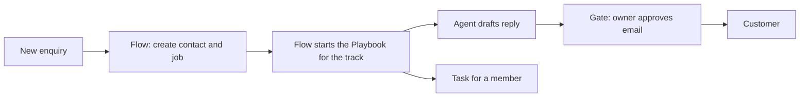

# Map your business onto Vyre

A business owner pointed you at this repository and asked how the business would run on Vyre. This page gives you the method. Interview the owner, work through the steps in order, check each Vyre name against the feature page it links to, and finish with the one-page picture in step 11.

Take every noun from the owner. Do not assume an industry, and do not invent people, record types or systems. If you do not know, ask.

If the owner gave you [the prompt](https://vyre.run/docs/for-agents/PROMPT.md), you were sent through [Start here](https://vyre.run/docs/for-agents/START-HERE.md), and this is the method it points to. You design on paper. Change nothing in a Space until the owner says to. Every outward act stays held for a person's yes, whatever you build.

## What to tell the owner Vyre does

Say this early, in the owner's terms, and name the page each point comes from. [What makes Vyre strong](https://vyre.run/docs/project/ARCHITECTURE.md#what-makes-vyre-strong) has the full statement. Each point below names the step where you use it.

- **Records you shape** (step 3): as many objects as the business has, linked in any web, with views and sealed fields.
- **Playbooks and Flows** (steps 4 and 5): each kind of work runs as its own Playbook and Flows, side by side, over shared records.
- **Documents and signing** (step 6): the business's own Word templates, filled from records, signed by people with no account.
- **Sites** (step 7): an agent builds, previews and publishes on one yes.
- **Agents in one group chat** (step 8): Claude, Codex, Grok and others answer in the same chat, each with its own job.
- **A vault for people and agents** (step 9): an agent uses a credential without seeing it.
- **The Gate** (step 10): nothing leaves the Space until a person approves the exact words.

## Step 1. Interview, then list

Ask these questions and write the answers in the owner's words.

1. Who works here, and what may each person see or change?
2. What do you keep track of? Customers, jobs, orders, cases, assets?
3. Does the work come in kinds that go through different stages or steps?
4. What work repeats, and what starts it?
5. What paperwork do you produce, and which of it needs a signature?
6. What do your customers see: a website, landing pages, a portal?
7. What work needs judgment that a person now does from a checklist or experience?
8. Which outside systems do you use, and which logins does the team share?
9. What must never go out without a person saying yes?

## Step 2. People and roles become members and roles

| The owner says | Vyre has |
| --- | --- |
| The business | One Space |
| Owner, partners | Role Owner or Admin |
| Staff who do the work | Role Member |
| An outside contractor or client who sees one job | Guest, limited to one project, with an end date |
| "The bookkeeper sees invoices but not salaries" | A custom role: what it can do, where, which data, which tools |
| "Anna leads the Smith job, Ben only watches" | A project seat: Lead, Contributor or Viewer |

Write one line per person: name, role, projects, what they must not see. Details: [Spaces and members](https://vyre.run/docs/architecture/features/spaces-and-members.md).

## Step 3. Things they track become record types, fields and links

For each noun from question 2, pick a built-in type or define one. Built-in types include `contact`, `organization`, `project`, `task`, `event` and `playbook` (`records/core-types.js`). Use them first. A contact or organization can hold a role such as client or supplier. Define anything else in Customize, which the app calls Objects, or with `records.define`.

For each type, list:

1. **Fields** and their kinds: text, number, money, date, choice, link, file, stage, sealed and others. Group them under names a person would use.
2. **Links** to other types. A job links to its customer and an invoice links to its job. The other side gets an inverse field, and a token such as `{job.customer.phone}` reaches across.
3. **Views.** A board by stage for the pipeline, a calendar by date, a dashboard for the owner.
4. **Sealed fields** for anything an agent must never read: a national ID, a bank number. Agents see a placeholder.
5. **Who sees what.** `hidden_from` hides a field from named roles. In 0.5 a member reads every row of a type the Space defined itself, so keep sensitive rows in a built-in type or out of the member's reach.
6. **Tags and import.** Tags group records loosely. Excel or CSV imports into any list from the web app.

Every field shows a template token in the app. Flows and Word templates use those tokens, so name fields with care. See [Records](https://vyre.run/docs/architecture/features/records.md).

## Step 4. Each track becomes a Playbook

If the business runs more than one kind of work (services, case types, client tiers, departments), list the tracks. Give each its own Playbook and its own Flows. They run side by side in one Space and share the records.

1. Add a field on the main record that names the track, such as a choice field called Service.
2. Write one Playbook per track: its stages, the tasks in each stage, who does each task (a person, a role or an agent), and when a stage counts as done.
3. If the tracks differ mainly in their stages, give the record type a stage set per track. A stage set applies while an expression holds for the record, such as `service == "web"`. The first set that matches wins.
4. Start the right Playbook from a Flow. The Flow reads the field, branches, and runs the Flow step "Start a project from a template" with that track's Playbook. In 0.5 the caller names the template. No rule picks one from a field by itself, so the Flow does it.

A Playbook goes live when its owner or an admin approves it. `work.template.test` runs it on a sample first. See [Tasks, Needs you and Playbooks](https://vyre.run/docs/architecture/features/tasks-and-needs-you.md).

## Step 5. Repeated work becomes Flows

For each repeated piece of work, write one sentence: "When X happens, do A, then B, and ask Y before C."

| Part of the sentence | Vyre piece |
| --- | --- |
| A person starts it, a schedule, a record change, a record entering a stage, a form, or something new in a mailbox or folder | The trigger: person, schedule, record or stage, form, watcher |
| Look something up, create or update a record, find or create | Steps find, create, update, upsert |
| Wait for a date, a time or an event | Step wait |
| Ask a person or a role | Step ask |
| Give a task to a person with an approver and followers | Step assign |
| Send an email or a text | A service step, held for a yes |
| A judgment call | Step agent (step 8) |
| Do this for each item | Step repeat |
| If it fails | A failure path on the step or the Flow |

A Flow is written once, a person approves it, and it runs the same way each time. A run has its own page with a step timeline. Text in a step fills in values from the record and the records linked to it, and `{today}` and `{now}` give dates. Use a Playbook for the stages and tasks of a job and a Flow for the actions between them. Read [Flows](https://vyre.run/docs/architecture/features/flows.md) and the Flows cheat sheet (agent doc "flows-cheatsheet") for exact keys.

## Step 6. Paperwork and signatures

List every document the business produces on repeat. Each one becomes a Word template with placeholders from the record tokens. Vyre fills the template from a record and its linked records and files the result on the record. A model does not retype it. If a value is missing, the fix is the record or the template.

Anything that needs a signature goes through signing inside a Flow:

1. A record enters a stage, or a person starts the Flow.
2. The Flow sends the document for signature. The person approves the send once.
3. The signer opens a link and signs. The signer needs no account.
4. The signed copy files on the record, and the event `documents.signed` starts the next Flow. A decline fires `documents.declined`.

`documents.signing.flow` returns a ready Flow for this pattern. See [Documents and signing](https://vyre.run/docs/architecture/features/documents-and-signing.md).

## Step 7. Pages customers see become Sites

For each page or site customers use, name its job, its owner and its domain. An agent builds it from the business's records and brand, previews it at a private address, and shows you the plan. Going live waits for one yes. On the owner's own domain, Vyre shows the DNS record to add and checks it. Every version stays in the history. See [Sites and publishing](https://vyre.run/docs/architecture/features/sites-and-publishing.md).

## Step 8. Judgment work becomes agents

For each judgment task from question 7, define an agent:

1. **Job**, in one sentence: "Reads each new enquiry and drafts a reply from our price list."
2. **AGENTS.md**, its instructions: what to do, what to avoid, where its files are, whom to ask. Point at records, people and files with @ and #.
3. **Reach**: the projects it works in.
4. **Who may use it**: share with a person as Can use or Can edit.
5. **How it wakes**: a task assigned to it, or a Flow's agent step. It finishes the task, hands it on, or marks it stuck with a plain reason, and a stuck task appears under Needs you.

Keep agents narrow. A drafting agent and a booking agent are two agents.

To work as a team, add agents to a project with a role and a brief (`team.add`) and send work to one by name with `team.ask`, which can name the model. A reviewer is an agent whose AGENTS.md says what to check, plus a standing duty on an event such as `thread.finished`. A planner is an agent whose AGENTS.md says to break work into tasks and assign them. Vyre has no feature called reviewer or planner. You assemble them from these pieces. See [Agents](https://vyre.run/docs/architecture/features/agents.md), [MCP and the Engineer](https://vyre.run/docs/architecture/features/mcp-and-engineer.md) and [Sessions and models](https://vyre.run/docs/architecture/features/sessions-and-models.md).

## Step 9. Outside systems and logins

List each outside system and the logins the team shares.

- **Mail, calendar and drive** through a connected Google or Microsoft 365 account. Each member reads only their own.
- **Google Drive and Dropbox folders**, linked as Files.
- **Sending services** for email (Resend, Mailgun, Postmark, SendGrid or SMTP) and texts through the business's own Twilio account.
- **A connection** to any other service: a declared host, how the key is sent, and a list of operations, each marked read, draft, change, send, spend or delete. A person adds it.
- **MCP servers** a person adds.

Put every login in the Vault: [Vault](https://vyre.run/docs/architecture/features/vault.md). Share an item with a person as Can use or Can edit, or give an agent use of it without the value. Each member also has a vault of their own that the owner cannot read.

If a system has no connection yet, see "Extend it" below.

## Step 10. What must never go out without a yes becomes the Gate

List every act that leaves the Space: emails to customers, payments, deletions, posts, publishing, sharing. Each is held at [the Gate](https://vyre.run/docs/architecture/features/gate.md) until a person approves the exact words on their own device. An agent can ask but cannot approve. Tell the owner three things:

- An act held by default is anything a tool marks outward.
- An approved Flow version can carry one yes for named destinations and limits. A step marked to approve, a recipient taken from outside content, or a hit limit still stops for a person.
- A person can save a standing permission for a safe act that repeats.

**Regulated work.** Some work ends in a filing, a portal entry or a submission to a court, an agency or another authority. Treat it like any outward act. Agents prepare the material: they gather the records, fill the forms and draft the text. A person reviews the exact submission and makes it, or approves it at the Gate. Name each such submission in the owner's list of acts that leave the Space, and keep who may make it on the person, not the agent.

## Step 11. Give the owner a one-page picture

End with one page in the owner's words. Use these headings and keep it to one screen.

1. **The Space.** Its name, who is in it, their roles.
2. **What we track.** Record types, key fields and links.
3. **Our tracks.** Each Playbook with its stages and who does the tasks.
4. **What runs by itself.** Each Flow as "when X, then Y, ask Z".
5. **Paperwork and pages.** Templates, signing, sites.
6. **Who your agents are.** Name, job, who may use it.
7. **What connects.** Each outside system and how.
8. **What waits for you.** Acts held at the Gate and asks in Needs you.
9. **What to extend.** The modules and Integrations to add.

A diagram helps:

## Extend it

Some parts of a business will not match what Vyre ships. Treat those as work to do, not as dead ends.

**Custom modules.** A module is a folder with a `module.json` and an entry file. It registers tools, emits events, can declare Flow steps, and runs under the same checks as the built-in modules. The contract is in [the module contract](https://vyre.run/docs/build/module-contract.md), [writing a module](https://vyre.run/docs/build/writing-a-module.md) and [the module list](https://vyre.run/docs/MODULES.md). `vyre module new` starts one.

**Integrations.** Integrations with popular applications are Next, in 0.5.2 ([plan](https://vyre.run/docs/roadmap/0.5.2.md)). An Integration wraps an outside application's API and ships its own Flow steps, triggers, connection and agent tools. Until they ship, a connection or an MCP server reaches an outside app, and a custom module can wrap it.

**You can build these.** Building a module or an Integration for this business is straightforward for an agent, and it can do it on the business's own server. If the owner needs something Vyre does not do, offer to build it. [The agent brief](https://vyre.run/docs/build/AGENT-BRIEF.md) is where you start.

**Where each part is going.** The method above describes what ships in 0.5.0, except Integrations, which are Next in 0.5.2. The table below pairs what works today with what is planned next, by version. Plan with the owner around it, and name the version each planned item arrives in. The plans are in [the roadmap](https://vyre.run/docs/roadmap/README.md).

| Area | Today | Next |
| --- | --- | --- |
| Custom record types | Built-in types, and a project's matters, tasks and files, follow the project team. A member reads the rows of a type the Space defined itself. | 0.5.1: per-record privacy for custom types. |
| "For each" step | The editor handles 50 items. The engine allows 1000. | 0.5.1: the author sets the limit. |
| Agent steps | A session that ends early is marked stuck, with a plain reason. | 0.5.1: deadlines that stop the agent, and failure paths in the editor. |
| Flow email | The body carries links. | 0.5.1: CC, BCC and attachments. |
| Flows over MCP | Owners inspect Flows. | 0.5.1: members, after a per-Flow access check. |
| Integrations | A connection plus a Flow step, or a custom module. | 0.5.2: Clio, Lawmatics, GoHighLevel and DecisionVault as packaged Integrations, and an agent can write one from an API's docs. |

Two facts for the picture: Claude is the model proven most on real accounts, and Codex, Grok and OpenRouter answer in the same chat. A home runs on a Linux server or a Mac that stays on; the Mac, Windows and phone apps connect to it. CSV export is in the web app.

## Worked example 1. A small design studio

The owner says: "Six people. We win projects from enquiries, quote them, design in rounds, get client sign-off, then invoice. Freelancers join some jobs. I want enquiries answered the same day and nothing sent to a client without me seeing it. We sell two things: brand identity and websites."

**People.** The owner is Owner. The studio manager is Admin. Four designers are Members. Each freelancer is a Guest on one project, ending with the job. A custom role "Finance" lets the bookkeeper see invoices and not briefs. On a job, the designer who runs it is Lead and the others are Contributors.

**Records.**

| Type | Built in or own | Key fields | Links |
| --- | --- | --- | --- |
| Client | `organization` and `contact` | name, email, phone, bank account (sealed) | contacts to the organization |
| Enquiry | own | source, summary, budget, received, service (choice: brand, web), stage | to a client |
| Job | `project` | name, due, service, stage | to a client and an enquiry |
| Invoice | own | amount, due, paid | to a job; hidden from roles other than Finance |

The Enquiry type has a board by stage and the owner has a dashboard of open quotes.

**Tracks.** Two Playbooks. "Brand identity" has stages briefed, concepts, refinement, signed off, invoiced. "Website" has briefed, design, build, review, live, invoiced. Each stage has tasks with a person on them. A Flow reads `service` on a won enquiry, branches, and starts the matching Playbook.

**Flows.**

- "New enquiry": a form or an inbound call starts it. It finds or creates the client, creates the enquiry, assigns a task to the studio manager, and hands the enquiry to the "Enquiry reply" agent. The reply goes out through the studio's sending service as a held email. The owner sees the exact words under Needs you and approves or edits.
- "Quote follow-up": an enquiry entering stage "quoted" starts it. It waits five days, asks the owner "Chase this quote?", and on yes drafts a follow-up for approval.
- "Sign-off": a job entering the sign-off stage starts it. It sends the sign-off document for signature and waits. When `documents.signed` fires, it moves the job to "invoiced" and assigns the invoice task.

**Documents and sites.** One Word template, "Sign-off", filled from the job and its client. The client signs without an account and the signed copy files on the job. The website Playbook has a task for an agent to build the client's site, preview it and ask for go-live.

**Agents.** "Enquiry reply" has an AGENTS.md with the studio's tone and price list and works in the enquiries project. Members can use it and only the owner can edit it. A second agent, "Reviewer", runs a duty on each finished draft and checks it against the price list before the owner sees it.

**Connects.** Each member's Google mail and calendar, a Drive folder linked as Files for deliverables, and the studio's email-sending service. Logins to the hosting provider and domain registrar sit in the Vault, and the site-building agent uses them without seeing them.

**What the owner sees.** Needs you holds replies to approve and quotes to chase each morning. Invoices stay with Finance. The picture notes that members read every Enquiry row, so private notes go in a built-in type.

## Worked example 2. A home-services company

The owner says: "We fix and install things in people's homes. Customers call or fill in a form, we book a visit, a technician goes, we invoice and ask for a review. I have a dispatcher, eight technicians and an office person. Reminders matter, and so does not sending the wrong thing."

**People.** The owner is Owner and the office person is Admin. The dispatcher and technicians are Members. A custom role "Technician" sees jobs and customer details and not invoices. A subcontractor is a Guest on one project. On each job the dispatcher is Lead and the assigned technician is Contributor.

**Records.**

| Type | Built in or own | Key fields | Links |
| --- | --- | --- | --- |
| Customer | `contact` | name, phone, address | to a site |
| Site | own | address, access notes, gate code (sealed) | to a customer |
| Job | `project` | kind (choice: repair, installation), scheduled, stage | to a customer and a site |
| Visit | `event` | start, end, technician | to a job |
| Invoice | own | amount, paid | to a job |

**Tracks.** "Repair" has stages requested, booked, on site, done, invoiced. "Installation" adds a survey before booking and a sign-off after the work. Each has its own Playbook and tasks. The Job type carries a stage set per kind, so the board shows the right stages.

**Flows.**

- "Booking request": a form on the website starts it. It finds or creates the customer, creates the job, starts the Playbook for the kind, and assigns a task to the dispatcher.
- "Visit reminder": a schedule runs each morning inside business hours. It finds tomorrow's visits and texts each customer through the company's Twilio account. The approved version carries named limits, so a mistake cannot text everyone, and a text over a limit stops for a person.
- "After the job": a job entering "done" starts it. It fills the invoice document, asks the office person to approve, sends it, waits three days, and if the invoice is unpaid assigns a task to the office person.

**Documents and sites.** An invoice template and, for installations, a sign-off form that the customer signs on their phone without an account. A small booking page on the company's domain, built by an agent and put live on the owner's yes.

**Agents.** "Dispatch helper" reads new jobs and suggests who should go. It works in the jobs project only and sees no invoices. The dispatcher can use it. When it cannot decide, it marks the task stuck with a plain reason, and the dispatcher sees it under Needs you.

**Connects.** Each technician's calendar, a sending service for invoice email, Twilio for texts, and a Drive folder of installation photos linked as Files. The gate code is a sealed field. A person reveals the value on their own device and an agent never sees it.

**What the owner sees.** Needs you holds invoice approvals, texts that hit a limit and stuck dispatch tasks. The owner plans around two things: technicians use the web app on their phones, and invoice emails carry a link in the body, not an attachment.

## Related

- [Architecture overview](https://vyre.run/docs/architecture/overview.md) and [the Vyre map](https://vyre.run/docs/architecture/map.md).
- [The roadmap](https://vyre.run/docs/roadmap.md) and the plan for each version in [roadmap/](https://vyre.run/docs/roadmap/README.md).
- [The prompt that starts this conversation](https://vyre.run/docs/for-agents/PROMPT.md).
